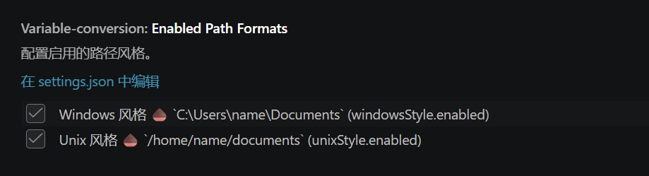

[English](README.md) · **简体中文** · [繁體中文](README.zh-TW.md) · [日本語](README.ja.md) · [한국어](README.ko.md) · [Deutsch](README.de.md) · [Français](README.fr.md) · [Español](README.es.md) · [Português (Brasil)](README.pt-BR.md) · [Italiano](README.it.md) · [Русский](README.ru.md) · [Polski](README.pl.md) · [Türkçe](README.tr.md) · [Čeština](README.cs.md) · [Magyar](README.hu.md)

  

<h1 align="center">变量命名转换助手</h1>

<em>一个强大的变量命名及路径风格转换插件，适用于 VS Code</em>

  <a href="https://marketplace.visualstudio.com/items?itemName=coder-xiaomo.variable-conversion">Marketplace</a> ·
  <a href="https://open-vsx.org/extension/coder-xiaomo/variable-conversion">OpenVSX</a> ·
  <a href="https://github.com/zhang-brook/variable-conversion-vscode-extension">GitHub</a> ·
  <a href="https://gitee.com/zhang-brook/variable-conversion-vscode-extension">Gitee</a>

支持一键转换、循环转换，可通过右键菜单、快捷键、状态栏等多种方式使用。

- ✅ 支持多选区
- ✅ 支持多窗口
- ✅ 支持撤回 & 重做（Ctrl + Z / Ctrl + Y）
- ✅ 支持仅开启部分目标转换格式

> 🔭 提示：如果下方图片无法显示，可[前往 Gitee 查看](https://gitee.com/zhang-brook/variable-conversion-vscode-extension/blob/main/README.zh-CN.md)。

## 如何使用？

### 循环转换

选中需要转换的内容，然后按下 `Ctrl + Alt + [` 或 `Ctrl + Alt + ]`，即可在可用的命名方式之间前后切换。

### 基础转换

**1. 选中代码中需要转换的内容**

**2. 按 `Shift + Alt + T`**

或者点击状态栏的 `变量转换` 按钮。

或者右键 → `变量转换`。

或者右键 → 将变量转换为...。

**3. 选择转换目标，转换完成。**

### 路径转换（Beta）

> 该功能仍在 Beta 测试阶段，如您在使用过程中遇到问题，欢迎通过文末联系方式进行反馈。

路径转换与变量转换的操作逻辑基本相同，都可以通过 *右键菜单*、*底部状态栏*、*快捷键* 等方式使用，唯一区别是快捷键的不同。

路径转换快捷键：

- 切换下一个路径风格：`Ctrl + Alt + /`
- 切换上一个路径风格：`Ctrl + Alt + Shift + /`

**注：** 目前仅支持 `Windows 风格路径` 与 `Unix 风格路径` 互转，所以这两个快捷键目前效果相同。后续会陆续增加其他更多路径风格（例如 `Windows Git Bash` 风格、浏览器 `file://` 协议风格等），敬请期待。

## 快捷键

| 功能                                 | 快捷键                 |
| ------------------------------------ | ---------------------- |
| 变量转换 快速选择                    | Shift + Alt + T        |
| 变量循环转换 → 上一个                | Ctrl + Alt + [         |
| 变量循环转换 → 下一个                | Ctrl + Alt + ]         |
| 显示格式顺序信息弹窗                 | Ctrl + Alt + \`        |
| 路径转换 快速选择                    | Shift + Alt + /        |
| 路径循环转换 → 上一个                | Ctrl + Alt + /         |
| 路径循环转换 → 下一个                | Ctrl + Shift + Alt + / |

> 若您觉得快捷键使用不顺手，可在 VS Code 左下角齿轮图标 ⚙ → 键盘快捷方式中自定义修改。

## 配置项

| 配置项                                   | 描述                                       | 配置示例                                                         | 默认值   |
| ---------------------------------------- | ------------------------------------------ | ---------------------------------------------------------------- | -------- |
| `variable-conversion.enabledFormats`     | 配置启用的变量命名方式。                   | `{ "xxxCase.enabled": boolean, ... }`                            | 见配置项 |
| `variable-conversion.formatOrder`        | 配置变量命名方式的显示顺序。               | `[ "camel_case", "pascal_case", "snake_case" ]`                  | 见配置项 |
| `variable-conversion.enabledPathFormats` | 配置启用的路径风格。                       | `{ "windowsStyle.enabled": boolean, "unixStyle.enabled": boolean }` | 见配置项 |

配置项概览：

<!--
GitHub 上这种表格高亮行会有问题（表头不会高亮）

|         |  |
| :----------------------------------------------------------: | :----------------------------------------------: |
|                   **Enabled Formats 配置**                   |              **Format Order 配置**               |
|  |                                              |
|                 **Enabled Path Formats 配置**                |                                              |
 -->

<table>
  <tr>
    <td align="center"><strong>Enabled Formats 配置</strong></td>
    <td align="center"><strong>Format Order 配置</strong></td>
  </tr>
  <tr>
    <td align="center"></td>
    <td align="center"></td>
  </tr>
  <tr>
    <td align="center" colspan="2"><strong>Enabled Path Formats 配置</strong></td>
  </tr>
  <tr>
    <td align="center" colspan="2"></td>
  </tr>
</table>

## 支持的类型

### 变量转换

| 类型                                       | Case                     | 举例             |
| ------------------------------------------ | ------------------------ | ---------------- |
| 小驼峰(驼峰)命名                           | Camel Case               | fooBar           |
| 大驼峰(帕斯卡)命名                         | Pascal Case              | FooBar           |
| 下划线(蛇形)命名                           | Snake Case               | foo_bar          |
| 下划线(蛇形) + 小驼峰(驼峰)命名            | Snake Camel Case         | foo_Bar          |
| 下划线(蛇形) + 大驼峰(帕斯卡)命名          | Snake Pascal Case        | Foo_Bar          |
| 下划线(蛇形) + 全大写命名                  | Snake Upper Case         | FOO_BAR          |
| 中划线(连字符/脊柱式)命名                  | Kebab Case / Spinal Case | foo-bar          |
| 中划线(连字符/脊柱式) + 小驼峰(驼峰)命名   | Kebab Camel Case         | foo-Bar          |
| 中划线(连字符/脊柱式) + 大驼峰(帕斯卡)命名 | Kebab Pascal Case        | Foo-Bar          |
| 中划线(连字符/脊柱式) + 全大写命名         | Kebab Upper Case         | FOO-BAR          |
| 空格分隔命名                               | Space Case               | foo bar          |
| 空格分隔 + 小驼峰(驼峰)命名                | Space Camel Case         | foo Bar          |
| 空格分隔 + 大驼峰(帕斯卡)命名              | Space Pascal Case        | Foo Bar          |
| 空格分隔 + 全大写命名                      | Space Upper Case         | FOO BAR          |
| 点分隔命名                                 | Dot Case                 | foo.bar          |
| 点分隔 + 小驼峰(驼峰)命名                  | Dot Camel Case           | foo.Bar          |
| 点分隔 + 大驼峰(帕斯卡)命名                | Dot Pascal Case          | Foo.Bar          |
| 点分隔 + 全大写命名                        | Dot Upper Case           | FOO.BAR          |
| 全小写                                     | Lower Case               | foo_bar / foobar |
| 全大写                                     | Upper Case               | FOO_BAR / FOOBAR |

### 路径转换

已支持的路径风格：

| 路径风格     | Style         | 举例                                           |
| ------------ | ------------- | ---------------------------------------------- |
| Windows 风格 | Windows Style | `C:\Windows\System32`  `.\public\assets\` |
| Unix 风格    | Unix Style    | `/usr/bin` `./public/assets/`             |

未来计划支持的路径风格：

| 路径风格                   | Style                             | 举例                                  |
| -------------------------- | --------------------------------- | ------------------------------------- |
| Windows 风格（反斜杠转义） | Windows Style (Backslash Escaped) | `C:\\Windows\\System32`               |
| Unix 风格（反斜杠转义）    | Unix Style (Backslash Escaped)    | `\/usr\/bin`                          |
| Windows Git Bash 风格      | Windows Git Bash Style            | `/c/Windows/System32`                 |
| 浏览器 `file://` 协议风格  | Browser `file://` protocol        | `file:///C:/Program%20Files%20(x86)/` |

## 小提示

#### 关于文本选区

- 可以先按住 `Alt` 键不放，再使用鼠标先后选中多个选区。
- 可以先按住 `Shift + Alt` 键不放，再按下鼠标左键，使用鼠标滑过需要选中的区块。
- 可以通过 `Ctrl + D` 快捷键选中光标所在的单词。

## 反馈

如果您觉得本插件还不够好用，有更好的使用建议，或者发现了 BUG，欢迎[前往 GitHub 仓库提 issue](https://github.com/zhang-brook/variable-conversion-vscode-extension/issues)。使用中文或 English 均可；不建议使用翻译软件，否则可能会让文字描述变得抽象难懂。

## 开源共建

本插件已开源（MIT License），欢迎提 PR 共建，让插件变得更好用！

GitHub Repo（开源地址）：https://github.com/zhang-brook/variable-conversion-vscode-extension.git

Gitee Mirror（码云镜像）：https://gitee.com/zhang-brook/variable-conversion-vscode-extension.git

-----

**玩得开心！**
